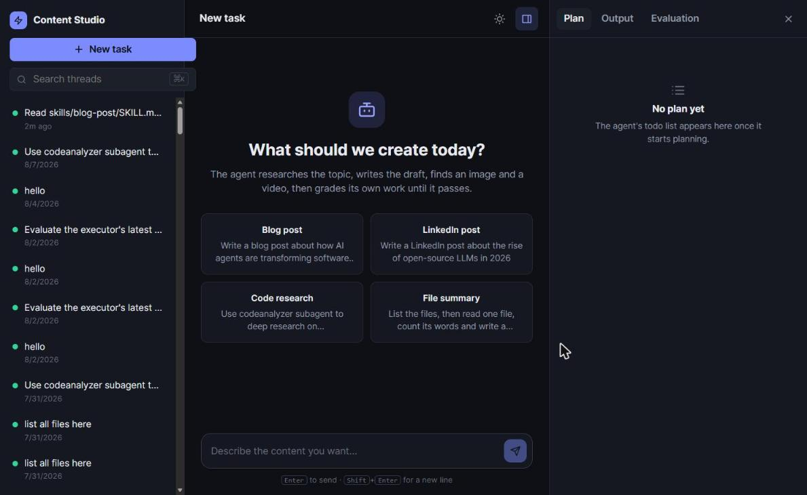
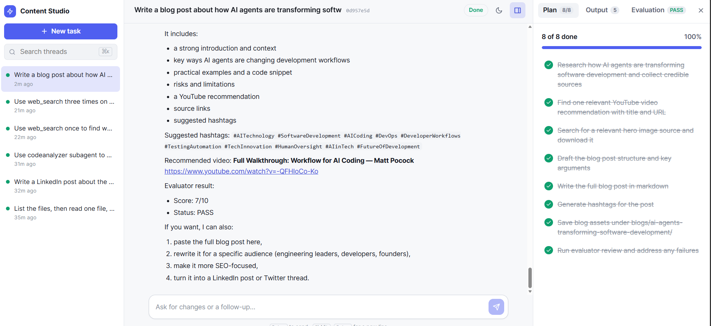
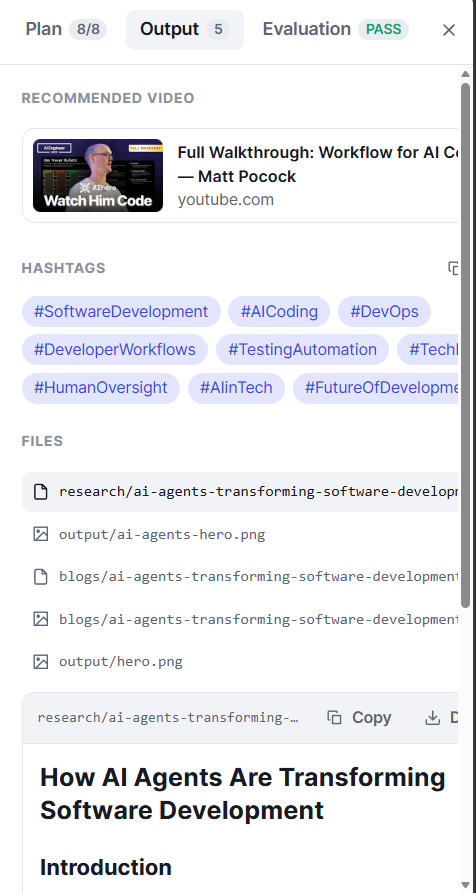
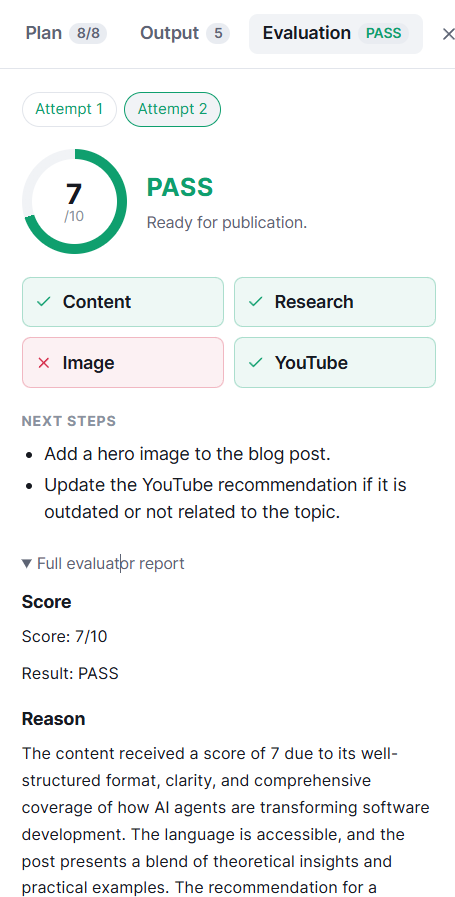

# Content Studio: a Deep Agent harness for research-backed content

A multi-agent content writer built on LangChain [Deep Agents](https://docs.langchain.com/oss/python/deepagents/overview). Give it a task like *"Write a blog post about how AI agents are transforming software development"*. It plans the work, sends research to subagents, writes the post, finds a cover image and a YouTube video, generates hashtags, then grades its own draft and revises until it passes.

It comes with a FastAPI streaming backend, a React UI that shows each step as it happens, a separate Docker sandbox for every conversation, and crash/resume from checkpoints.



## Table of Contents
- [What it can do](#what-it-can-do)
- [How it works](#how-it-works)
- [Project structure](#project-structure)
- [Setup](#setup)
  - [Option A: Docker Compose (everything)](#option-a-docker-compose-everything)
  - [Option B: Makefile (one piece at a time)](#option-b-makefile-one-piece-at-a-time)
- [Configuration](#configuration)
- [Streaming event protocol](#streaming-event-protocol)

## What it can do

### Plan the work and show every step live
The agent writes a todo list (`write_todos`), and the **Plan** tab ticks it off as it works. Every tool call (web search, file reads and writes, image download) appears as a card you can expand to see its input, output and duration. The answer text streams in as it's written.


When the run finishes, the chat shows a summary of the post (its sections, hashtags, recommended video and evaluator result), and the Plan tab shows every step done (8 of 8).



### Hand work to subagents
Research, evaluation and other jobs go to subagents. Some are defined locally (`researcher`, `evaluator` in `subagents.yaml`). Others are remote A2A agents (`code_analyzer`, `infotainment`, `todolist` in `agents/`). Each one gets its own card showing what it was asked to do, the steps it took and the result it returned.


### Collect everything the post needs
The **Output** tab gathers what the agent produced: the recommended YouTube video (with thumbnail), the hashtags (copy all at once), and every file it wrote, with a preview and download (markdown posts render, images display inline).




### Grade its own draft and revise
The `evaluator` subagent scores the draft out of 10. A missing image or YouTube link fails it automatically, and anything 5 or below goes back to the writer for another round. The **Evaluation** tab shows the score, the verdict, each check, the next steps and every attempt.


Each attempt keeps its own report. Below, attempt 2 passes with 7/10, but the Image check still fails, so the next steps tell the writer to add a hero image.



### Recover from crashes
Each step is checkpointed (`JsonFileSaver`, saved in `memory/state.json`). If a run crashes, the connection drops or you press **Stop** (or Esc), a banner offers **Resume**, which continues from the last checkpoint. Add `?debug=1` to the URL to get a **Simulate crash** button that makes the next tool call fail on purpose.

### Keep every conversation
Threads are listed from the checkpointer, so they survive server restarts. You can search them (⌘/Ctrl+K), open one by URL (`#/t/<thread_id>`), and reloading a page rebuilds it exactly as it looked live. The UI has light and dark themes and fits narrow screens: the side panels turn into drawers.

## How it works

```
React UI (frontend/)  ──POST /api/run (SSE)──▶  FastAPI (backend/main.py)
        ▲                                          │  one DeepAgentRunner + Docker sandbox per thread
        │  token / tool_call / todos / ...          ▼
        └───────── stream_events.EventMapper ◀── agent.stream(stream_mode=["updates","messages"],
                                                              subgraphs=True, version="v2")
```

- **`backend/agent_runner.py`**: `DeepAgentRunner` builds the deep agent (`create_deep_agent`) with custom tools, local and A2A subagents, skills, `AGENTS.md` memory and the todo and crash middleware. It streams using LangGraph's v2 stream format, with subagent output included. `RunnerPool` gives each thread its own runner and Docker sandbox.
- **`backend/stream_events.py`**: `EventMapper` turns raw LangGraph chunks into a small JSON event protocol. It tags each event with the subagent it came from, removes duplicate messages, and parses evaluator reports.
- **`backend/main.py`**: the SSE endpoints (run, resume, stop, simulate crash).
- **`backend/routes_threads.py`**: the thread history API (read through the graph, so no container is needed) and file serving from the thread's sandbox or the host `output/` folder.
- **`backend/crash.py`**: `CrashMiddleware`, which makes the next tool call fail on purpose so you can try resume.

## Project structure
```
backend/                  FastAPI backend (run as the `backend` package)
  main.py                 API: run/resume streaming (SSE), stop, simulate crash
  routes_threads.py       API: thread history and agent files
  agent_runner.py         DeepAgentRunner (builds the agent, v2 streaming) + RunnerPool
  deps.py                 shared model client, checkpointer and runner pool
  crash.py                CrashMiddleware: simulated crash for the resume demo
  stream_events.py        LangGraph stream -> UI events, evaluator parser
  config.py               all paths and settings in one place
  tools.py                tools: web_search, download_image, generate_hashtags, move_file
  subagent_registry.py    loads local subagents (YAML) and discovers remote A2A ones
  subagents.yaml          local subagents (researcher, evaluator)
  agent_list.json         A2A agent URLs for local runs (localhost)
  agent_list.compose.json A2A agent URLs inside Docker Compose (service names)
  docker_sandbox.py       per-thread Docker sandbox backend
  json_saver.py           file-backed checkpointer
  prompts.py              todo-list prompts
  Dockerfile
agents/                   standalone A2A agents: infotainment, todolist, code_analyzer
skills/                   skill playbooks: blog-post, social-media, code-analysis
AGENTS.md                 brand voice + workflow (copied into every sandbox with skills/)
frontend/                 React + Vite UI
  src/api/client.js       REST + SSE client
  src/constants.js        tool-call labels
  src/state/threadReducer.js  event -> UI state
  src/hooks/              useAgentStream (run/resume/stop), useThreads
  src/components/         Sidebar, Conversation, Timeline, RunPanel, Composer, CrashBanner
memory/                   runtime checkpoints: state.json, memory.json (git-ignored)
output/                   images downloaded by the agent (git-ignored)
docker-compose.yml        Option A: the whole stack
Makefile                  Option B: each piece on its own
```

## Setup

**You need:** Docker running (on Windows/WSL: start Docker Desktop and enable *Settings → Resources → WSL Integration* for your distro; `docker info` should work), plus `uv` and Node 20+ for Option B.

Create your `.env` once:
```bash
cp .env.example .env   # then fill in OPENAI_API_KEY and TAVILY_API_KEY
```

| Service | Port |
|---|---|
| Frontend | http://localhost:5173 |
| Backend API | http://localhost:8000 |
| infotainment agent | 8004 |
| todolist agent | 8005 |
| code_analyzer agent | 8007 |

### Option A: Docker Compose (everything)
Starts the backend, frontend and all three A2A agents:
```bash
docker compose up --build
```
Open http://localhost:5173. Stop everything with:
```bash
docker compose down
```
Shortcuts: `make up` (detached), `make logs`, `make down`.

Notes:
- The backend mounts `/var/run/docker.sock` so it can create one sandbox container per conversation; `code_analyzer` mounts it too, to attach to those sandboxes.
- `memory/` and `output/` are mounted from your machine, so threads survive `docker compose down`.
- Inside Compose the backend reaches the agents by service name (`backend/agent_list.compose.json`, picked via `AGENT_LIST_PATH`).

### Option B: Makefile (one piece at a time)
Useful when you're working on one part. Install dependencies once:
```bash
make install
```
Start the A2A agents (each in its own container on localhost):
```bash
make agents
```
Or start just one: `make agent-infotainment`, `make agent-todolist`, `make agent-code-analyzer`.

Then, in two terminals:
```bash
make be
```
```bash
make fe
```
Open http://localhost:5173. Add `?debug=1` to the URL to show the **Simulate crash** button. Stop the agents with:
```bash
make agents-stop
```
The agents are optional: if one isn't running, the backend skips it and the rest still works.

## Configuration
Settings live in `backend/config.py`; secrets and overrides come from `.env`:

| Variable | Where | Default |
|---|---|---|
| `OPENAI_API_KEY`, `TAVILY_API_KEY` | `.env` | required |
| `LANGFUSE_PUBLIC_KEY`, `LANGFUSE_SECRET_KEY`, `LANGFUSE_BASE_URL` | `.env` | optional tracing |
| `CORS_ORIGINS` | `.env`, comma-separated | `http://localhost:5173` |
| `AGENT_LIST_PATH` | env | `backend/agent_list.json` |
| `VITE_API_BASE` | frontend | `http://localhost:8000` |

## Streaming event protocol
`POST /api/run` and `POST /api/resume` return Server-Sent Events. Each `data:` line is one JSON event:

| Event | Meaning |
|---|---|
| `thread` | thread id assigned to the run |
| `token` | incremental AI text (`msg_id`, `text`, `agent`, `parent`) |
| `message` | finalized human/AI message |
| `tool_call` / `tool_result` | tool name, args, output, status |
| `subagent_start` / `subagent_end` | a `task` delegation to a subagent and its result |
| `todos` | the full todo list |
| `file` | a file the agent wrote or downloaded |
| `evaluation` | evaluator score, PASS/FAIL, checks, next steps |
| `crash`, `stopped`, `done` | run lifecycle |

Other endpoints:
- `GET /api/threads`: list threads.
- `GET /api/threads/{id}`: replay a thread as events.
- `GET /api/threads/{id}/files/raw?path=`: serve a file.
- `POST /api/threads/{id}/stop`: stop a running thread.
- `POST /api/arm_crash`: debug crash.
- `POST /api/close/{id}`: remove a thread's sandbox.
