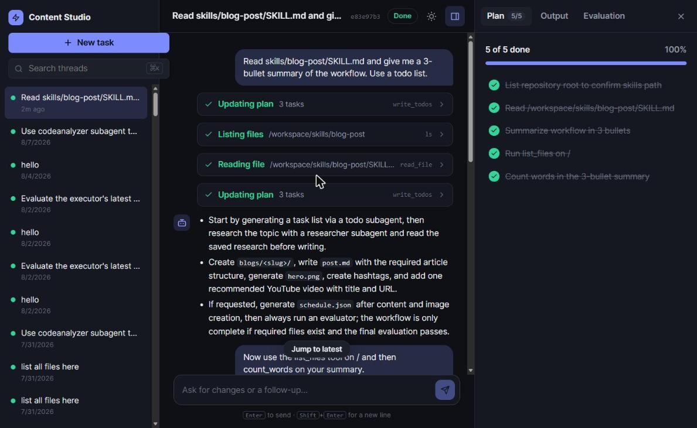
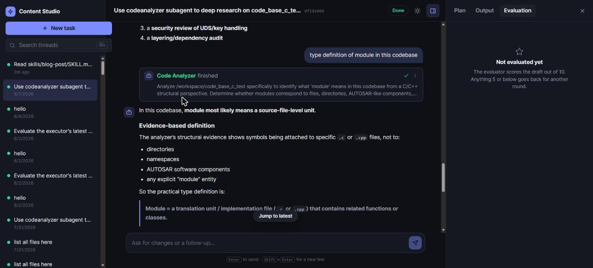
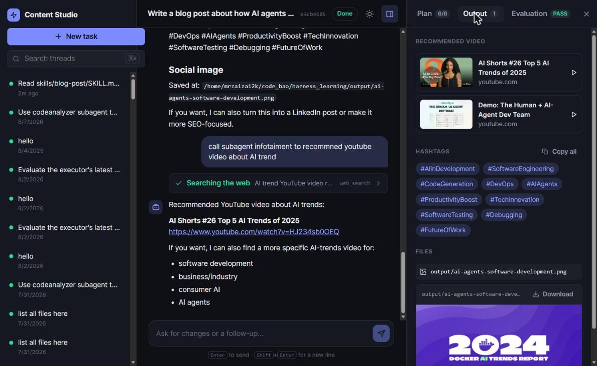
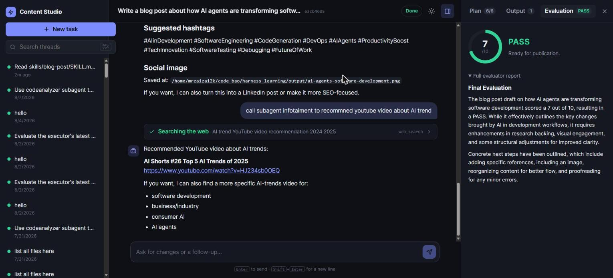

# Content Studio: a Deep Agent harness for research-backed content

A multi-agent content writer built on LangChain [Deep Agents](https://docs.langchain.com/oss/python/deepagents/overview). Give it a task like *"Write a blog post about how AI agents are transforming software development"*. It plans the work, sends research to subagents, writes the post, finds a cover image and a YouTube video, generates hashtags, then grades its own draft and revises until it passes.

It comes with a FastAPI streaming backend, a React UI that shows each step as it happens, a separate Docker sandbox for every conversation, and crash/resume from checkpoints.


## Table of Contents
- [What it can do](#what-it-can-do)
- [How it works](#how-it-works)
- [Project structure](#project-structure)
- [How to run](#how-to-run)
- [Configuration](#configuration)
- [Streaming event protocol](#streaming-event-protocol)

## What it can do

### Plan the work and show every step live
The agent writes a todo list (`write_todos`), and the **Plan** tab ticks it off as it works. Every tool call (web search, file reads and writes, image download) appears as a card you can expand to see its input, output and duration. The answer text streams in as it's written.



### Hand work to subagents
Research, evaluation and other jobs go to subagents. Some are defined locally (`researcher`, `evaluator` in `subagents.yaml`). Others are remote A2A agents (`code_analyzer`, `infotainment`, `todolist` in `agents/`). Each one gets its own card showing what it was asked to do, the steps it took and the result it returned.



### Collect everything the post needs
The **Output** tab gathers what the agent produced: the recommended YouTube video (with thumbnail), the hashtags (copy all at once), and every file it wrote, with a preview and download (markdown posts render, images display inline).



### Grade its own draft and revise
The `evaluator` subagent scores the draft out of 10. A missing image or YouTube link fails it automatically, and anything 5 or below goes back to the writer for another round. The **Evaluation** tab shows the score, the verdict, each check, the next steps and every attempt.



### Recover from crashes
Each step is checkpointed (`JsonFileSaver`, saved in `state.json`). If a run crashes, the connection drops or you press **Stop** (or Esc), a banner offers **Resume**, which continues from the last checkpoint. Add `?debug=1` to the URL to get a **Simulate crash** button that makes the next tool call fail on purpose.

### Keep every conversation
Threads are listed from the checkpointer, so they survive server restarts. You can search them (⌘/Ctrl+K), open one by URL (`#/t/<thread_id>`), and reloading a page rebuilds it exactly as it looked live. The UI has light and dark themes and fits narrow screens: the side panels turn into drawers.

## How it works

```
React UI (frontend/)  ──POST /api/run (SSE)──▶  FastAPI (main.py)
        ▲                                          │  one DeepAgentRunner + Docker sandbox per thread
        │  token / tool_call / todos / ...          ▼
        └───────── stream_events.EventMapper ◀── agent.stream(stream_mode=["updates","messages"],
                                                              subgraphs=True, version="v2")
```

- **`agent_runner.py`**: `DeepAgentRunner` builds the deep agent (`create_deep_agent`) with custom tools, local and A2A subagents, skills, `AGENTS.md` memory and the todo middleware. It streams using LangGraph's v2 stream format, with subagent output included.
- **`stream_events.py`**: `EventMapper` turns raw LangGraph chunks into a small JSON event protocol. It tags each event with the subagent it came from, removes duplicate messages, and parses evaluator reports.
- **`main.py`**: SSE endpoints, the thread history API (read through the graph, so no container is needed), and file serving from the thread's sandbox or the host `output/` folder.

## Project structure
- `main.py`: FastAPI app (streaming, threads, files, stop/resume).
- `agent_runner.py`: `DeepAgentRunner` (agent construction, v2 streaming, crash simulation).
- `stream_events.py`: LangGraph stream → UI event mapper and evaluator parser.
- `docker_sandbox.py`: Docker sandbox backend (`PydanticDockerSandboxBackend`).
- `json_saver.py`: file-backed checkpointer (`state.json`).
- `subagent_registry.py`, `agent_list.json`: discovery of remote A2A subagents.
- `subagents.yaml`: local subagents (`researcher`, `evaluator`).
- `tool_manager.py`: tools (`web_search`, `download_image`, `generate_hashtags`, ...).
- `skills/`: skill playbooks (`blog-post`, `social-media`, `code-analysis`).
- `agents/`: standalone A2A agents (`code_analyzer`, `infotainment`, `todolist`).
- `frontend/`: React + Vite UI.
  - `src/api/client.js`: REST + SSE client.
  - `src/state/threadReducer.js`: event → UI state.
  - `src/hooks/`: `useAgentStream` (run/resume/stop) and `useThreads`.
  - `src/components/`: Sidebar, Conversation, Timeline (message, tool and subagent cards), RunPanel (Plan / Output / Evaluation), Composer, CrashBanner.
  - `src/styles/`: design tokens (light/dark), layout, components.

## How to run

Backend (needs Docker running and `OPENAI_API_KEY` / `TAVILY_API_KEY` in `.env`):
```bash
uvicorn main:app --reload --port 8000
```

Frontend:
```bash
cd frontend
npm install
npm run dev
```
Open http://localhost:5173. Add `?debug=1` to show the **Simulate crash** button.

Subagent (example: infotainment):
```bash
docker build -t infotainment_agent agents/infotainment

docker run -d \
  --name infotainment_agent \
  -p 8004:8004 \
  --add-host=host.docker.internal:host-gateway \
  --env-file ./.env \
  -v "$(pwd)/agents/infotainment:/app" \
  infotainment_agent
```

## Configuration
| Variable | Where | Default |
|---|---|---|
| `VITE_API_BASE` | frontend | `http://localhost:8000` |
| `CORS_ORIGINS` | backend, comma-separated | `http://localhost:5173` |

## Streaming event protocol
`POST /api/run` and `POST /api/resume` return Server-Sent Events. Each `data:` line is one JSON event:

| Event | Meaning |
|---|---|
| `thread` | thread id assigned to the run |
| `token` | incremental AI text (`msg_id`, `text`, `agent`, `parent`) |
| `message` | finalized human/AI message |
| `tool_call` / `tool_result` | tool name, args, output, status |
| `subagent_start` / `subagent_end` | a `task` delegation to a subagent and its result |
| `todos` | the full todo list |
| `file` | a file the agent wrote or downloaded |
| `evaluation` | evaluator score, PASS/FAIL, checks, next steps |
| `crash`, `stopped`, `done` | run lifecycle |

Other endpoints:
- `GET /api/threads`: list threads.
- `GET /api/threads/{id}`: replay a thread as events.
- `GET /api/threads/{id}/files/raw?path=`: serve a file.
- `POST /api/threads/{id}/stop`: stop a running thread.
- `POST /api/arm_crash`: debug crash.
- `POST /api/close/{id}`: remove a thread's sandbox.
